# ccs — Claude Code Sessions

`ccs` lists every [Claude Code](https://docs.anthropic.com/en/docs/claude-code) session you have run, across all your projects, newest first. Search it, preview what you asked, and press Enter to jump back into a session in the right folder.



*The demo runs on made-up sessions ([demo/make_demo.py](demo/make_demo.py)).*

## Why not `claude --resume`?

The built-in picker only shows sessions of the folder you are in. `ccs` shows all of them in one place, with the project, cost, duration and state of each, and opens a session from any directory.

## Install

One command, on macOS or Linux:

```bash
curl -fsSL https://raw.githubusercontent.com/linnykoleh/cc-sessions/main/install.sh | bash
```

The script installs what is missing and then the `ccs` command itself:

| What | Why | How |
|---|---|---|
| [uv](https://docs.astral.sh/uv/) | installs and runs `ccs` in its own environment | `mise use -g uv`, else Homebrew |
| [fzf](https://github.com/junegunn/fzf) | the interactive list | `mise use -g fzf`, else Homebrew |
| `ccs` | this tool (Python 3.9+, no other packages) | `uv tool install` |

Run the same command again to upgrade.

Already have uv and fzf? Install directly:

```bash
uv tool install git+https://github.com/linnykoleh/cc-sessions
# or
pipx install git+https://github.com/linnykoleh/cc-sessions
```

From a clone:

```bash
git clone https://github.com/linnykoleh/cc-sessions.git
cd cc-sessions
./install.sh          # or: mise run install
```

## Usage

```bash
ccs                 # interactive list
ccs --list          # plain table, no fzf
ccs --version
ccs --help
```

| Key | Action |
|---|---|
| type | filter by title, project or date |
| ↑ ↓ | move; the preview follows |
| Enter | resume the session in its folder (`cd <folder> && claude --resume <id>`) |
| Esc | quit |

Search examples (fzf fuzzy search, words narrow it down):

| Type | Finds |
|---|---|
| `payments` | sessions in the `payments-api` project |
| `'2026-11-2` | sessions from 20–29 November 2026 (`'` = exact match) |
| `refund retry` | sessions whose title mentions both words |

`--list` is handy in scripts:

```bash
ccs --list | grep payments-api                    # all sessions of one project
ccs --list | awk -F'\t' '$1 >= "2026-11-20"'         # sessions since 20 November
```

### Statistics

The table on top sums your sessions for today, the last 7 days, the last 30 days and everything `ccs` can see. A session counts in a period if you worked in it then. COST and CLAUDE TIME count only what was spent in the period, by the day of each message, so a session started yesterday and continued today adds only today's part to Today. CLAUDE TIME is how long Claude worked on its turns, not how long the session was open. Top projects are the three that cost the most overall.

The line under the keys counts sessions by status.

### Columns

| Column | Meaning |
|---|---|
| LAST ACTIVITY | time of the last message, local time |
| PROJECT | the folder the session ran in |
| COST | what the tokens would cost at Anthropic API list prices, subagents included. On a subscription this is not what you pay; it shows how much work went into the session |
| TIME | from the first to the last message |
| (status) | `●` Claude is working in it right now; `○` it is open in a terminal and waits for you; `!` it was closed before Claude finished its turn: you pressed Esc, declined a tool, or your last prompt got no answer. Blank: closed after Claude answered |
| TITLE | the name you gave it with `/rename`, else Claude's title, else your first prompt. It comes last, so a narrow window cuts only the title |

## How it works

- Claude Code stores each session as `~/.claude/projects/<project>/<session-id>.jsonl`, and its subagents under `<session-id>/subagents/`. A running Claude Code registers its session in `~/.claude/sessions/<pid>.json`, which gives `●` and `○`. `ccs` reads these files and nothing else; your sessions never leave your machine.
- Prices come from [LiteLLM's public price table](https://github.com/BerriAI/litellm/blob/main/model_prices_and_context_window.json), the same source [ccusage](https://github.com/ryoppippi/ccusage) uses. `ccs` downloads it once a week and keeps only the Claude models. Costs match ccusage within a few cents per session, except for sessions forked from another session.
- Everything it reads is cached in `~/.cache/cc-sessions`. The first run reads all sessions (a few seconds for a few GB); after that only sessions that changed are read again.

Settings, all optional:

| Variable | Default | Meaning |
|---|---|---|
| `CLAUDE_CONFIG_DIR` | `~/.claude` | where Claude Code keeps its data |
| `XDG_CACHE_HOME` | `~/.cache` | where the cache goes |
| `CCS_OFFLINE` | unset | `1` = never download prices; COST shows `—` until a price table is cached |
| `FZF` | `fzf` on PATH | path to a specific fzf binary |

## Keep more history

Claude Code deletes sessions older than 30 days by default. To keep a year of them, add this to `~/.claude/settings.json`:

```json
{ "cleanupPeriodDays": 365 }
```

## Uninstall

```bash
curl -fsSL https://raw.githubusercontent.com/linnykoleh/cc-sessions/main/install.sh | bash -s -- --uninstall
# or: uv tool uninstall cc-sessions && rm -rf ~/.cache/cc-sessions
```

uv and fzf stay installed.

## Troubleshooting

- **`ccs: command not found` after installing.** uv puts commands in `~/.local/bin`. Run `uv tool update-shell` and open a new terminal.
- **COST shows `—`.** The price table could not be downloaded (no internet, proxy) and none is cached yet, or the model is too new for the table. It fills in on a later run.
- **Old sessions are missing.** Claude Code already deleted them; see [Keep more history](#keep-more-history).
- **"Folder … no longer exists".** The project folder was moved or deleted. The message shows the session ID, so you can still run `claude --resume <id>` from the new location.

## Development

```bash
mise install            # uv and fzf
mise run test           # or: uv run --group dev pytest -q
uv run ccs --list       # run from the checkout
python demo/record.py   # re-record demo/ccs.svg on made-up sessions (needs tmux)
```

The code is in `src/ccs/`: `sessions.py` reads transcripts, `pricing.py` handles prices, `index.py` the cache, `cli.py` the list and fzf.
